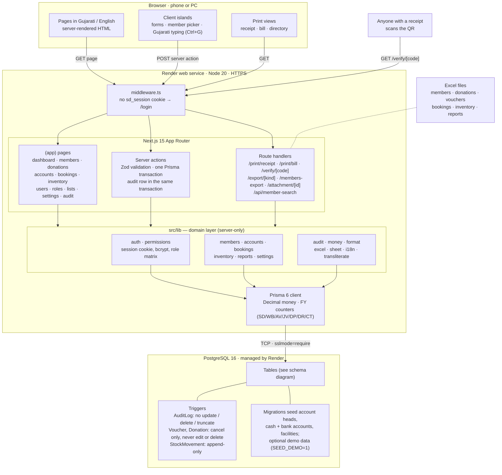
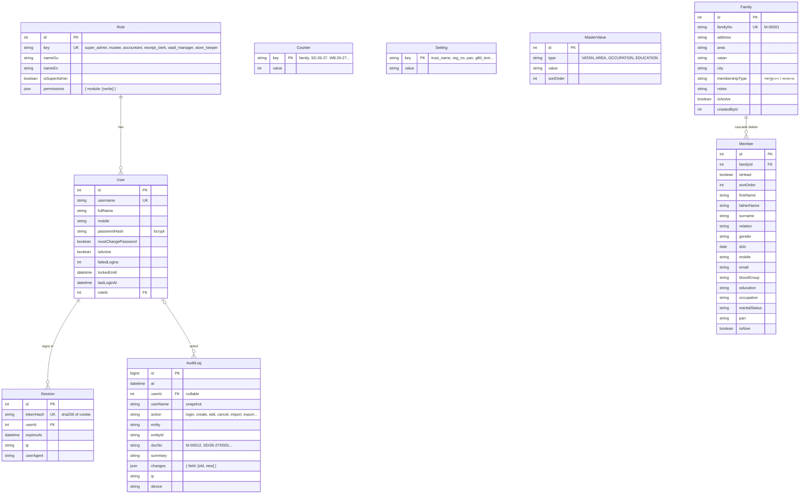
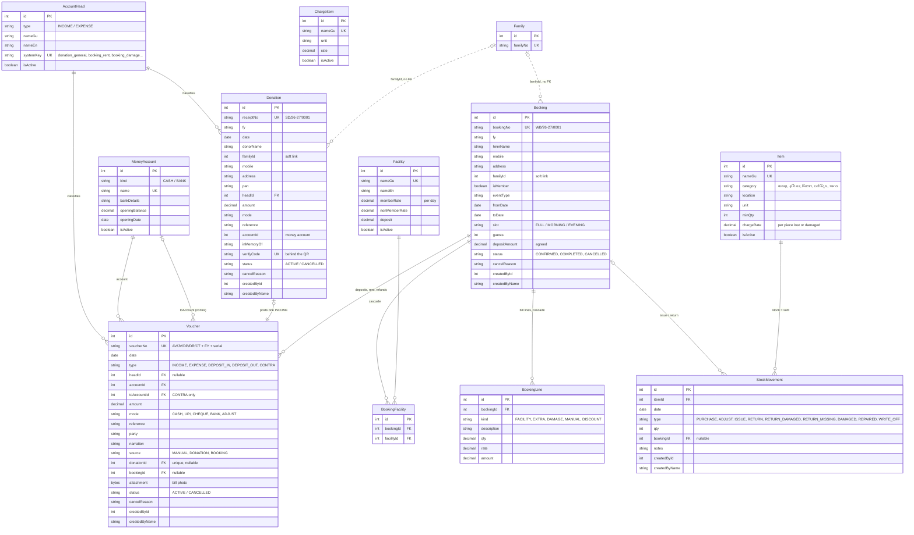

# શ્યામધામ મધુરમ portal — architecture and data model

Diagrams are in Mermaid, so GitHub renders them in place. The same source feeds the published architecture page.

## Tech stack

| Layer | Choice | Notes |
| --- | --- | --- |
| UI | React 19, Next.js 15 App Router | Server components by default; small client islands (forms, member picker, Gujarati typing) |
| Language | TypeScript 5.9 | Strict; Zod 4 validates every form on the server |
| Styling | Hand-written CSS (`globals.css`) | Gujarati-first, phone layout, print styles for receipts and bills |
| Server | Next.js server actions and route handlers | Node runtime on the same process; no separate API server |
| Data access | Prisma 6 | Migrations in `prisma/migrations`, Decimal money columns |
| Database | PostgreSQL 16 | Append-only triggers on audit log, vouchers, donations and stock movements |
| Auth | Cookie session (`sd_session`), bcrypt 12 rounds | Token hash stored, lockout after failed logins, forced password change |
| Authorisation | Role permission matrix (`lib/permissions.ts`) | Six roles; super admin passes every check |
| Documents | ExcelJS, qrcode | Excel exports, printable receipts and bills with a QR verification link |
| i18n | Gujarati default, English toggle | Cookie-based; `t.g(gu, en)` helper |
| Gujarati input | `lib/transliterate.ts` + `GujaratiTyping` | English letters to Gujarati in any text field, Ctrl+G to toggle |
| Tests | Playwright (Chromium), tsx unit tests | 40 end-to-end checks against a throwaway database |
| Hosting | Render web service + managed PostgreSQL (Mumbai) | `npm ci && npx prisma migrate deploy && npm run build`, then `npm start` |

## Architecture

### Request lifecycle

1. The middleware only checks that the `sd_session` cookie exists; it never touches the database.
2. Every page and action calls `requirePage` / `requirePermission`, which loads the session, confirms the user is active and checks the role's permission for that module and verb.
3. A write runs in one Prisma transaction: validate with Zod, allocate the financial-year document number from `Counter`, write the record, append the `AuditLog` row with field-level changes.
4. Money never changes shape after it is written. Receipts and vouchers are cancelled with a reason and stay in the ledger; database triggers reject any other update or delete.
5. Reports and balances are computed from vouchers and stock movements; no balance or stock count is stored.

## Database schema

Two diagrams, split by module. Solid lines are real foreign keys. Dotted lines are soft links held as plain integer columns (`familyId` on donations and bookings) so a family can be removed without touching money records.

### Foundation and members

### Money, bookings and stock

### Integrity rules enforced in the database

| Table | Trigger | Rule |
| --- | --- | --- |
| AuditLog | `audit_log_no_update_delete`, `audit_log_no_truncate` | Append-only, even for a superuser session |
| Voucher | `voucher_ledger_guard`, `voucher_no_truncate` | Only `status`, `cancelReason`, `cancelledAt`, `cancelledById` may change; no delete |
| Donation | `donation_ledger_guard`, `donation_no_truncate` | Same cancel-only rule |
| StockMovement | `stock_movement_append_only` | No update or delete; corrections are new ADJUST rows |

### Document numbers

All numbers reset each financial year (April to March) and come from the `Counter` table inside the writing transaction, so two clerks never get the same number.

| Prefix | Document | Example |
| --- | --- | --- |
| M | Family | `M-00012` (never resets) |
| SD | Donation receipt | `SD/26-27/0001` |
| WB | Wadi booking | `WB/26-27/0001` |
| AV | Income voucher | `AV/26-27/0001` |
| JV | Expense voucher | `JV/26-27/0001` |
| DP / DR | Deposit in / deposit out | `DP/26-27/0001` |
| CT | Contra (cash to bank) | `CT/26-27/0001` |
